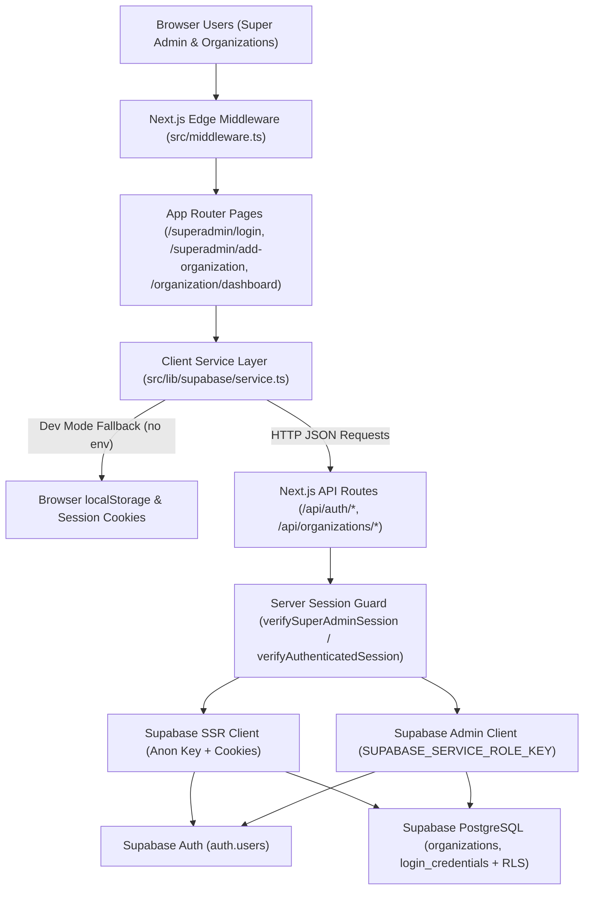

# Lume Connect

[](https://nextjs.org/)
[](https://react.dev/)
[](https://www.typescriptlang.org/)
[](https://tailwindcss.com/)
[](https://supabase.com/)
[](#)

> **All-in-One Communication & Collaboration Platform for Startups — Multi-Tenant Super Admin & Organization Portal**

---

## Table of Contents

- [Project Overview](#project-overview)
- [Tech Stack](#tech-stack)
- [System Architecture & Authentication Flow](#system-architecture--authentication-flow)
- [Folder Structure](#folder-structure)
- [API Endpoints Reference](#api-endpoints-reference)
- [Getting Started & Environment Setup](#getting-started--environment-setup)
- [Available Scripts](#available-scripts)
- [Roadmap & Active Tasks](#roadmap--active-tasks)

---

## Project Overview

**Lume Connect** (`lume-connect`, currently **v1.0.0** in active development on the `Develop` branch) is designed as an all-in-one communication and collaboration platform for startups.

In the current codebase, the foundational **multi-tenant authentication, Super Admin onboarding, and organization lifecycle management** layer is implemented:

- **Central Super Admin Portal (`/superadmin/login`, `/superadmin/add-organization`)**: Authenticates the platform Super Administrator (`admin@lumeconnect.com`), provisions new tenant organizations, searches and monitors active organizations in a live directory, and permanently deletes tenant organizations (revoking both database records and Supabase Auth access).
- **Tenant Organization Portal (`/organization/dashboard`)**: Dedicated workspace for authenticated client organizations with Role-Based Access Control (RBAC) isolation.
- **Security & Database Isolation**: Enforced via Next.js middleware (`frontend/src/middleware.ts`), server-side Supabase session verification (`frontend/src/lib/supabase/server.ts`), and PostgreSQL Row Level Security (RLS) policies in `supabase/schema.sql`.

---

## Tech Stack

Verified from [`package.json`](package.json) and [`frontend/package.json`](frontend/package.json):

| Layer | Technology / Package | Version |
|---|---|---|
| **Framework** | Next.js (App Router, Turbopack) | `16.4.6` |
| **UI Library** | React & React DOM | `19.3.0` |
| **Language** | TypeScript | `^5` |
| **Styling** | Tailwind CSS (`tailwindcss`, `@tailwindcss/cli`, `@tailwindcss/postcss`, `@tailwindcss/turbopack`) | `4.3.3` / `^4.3.5` |
| **Icons** | Lucide React (`lucide-react`) | `^1.76.0` |
| **Backend & Database** | Supabase PostgreSQL & Auth (`@supabase/supabase-js`, `@supabase/ssr`) | `^2.119.2` / `^0.12.7` |
| **Linting & CI** | ESLint (`eslint`, `eslint-config-next`) & GitHub Actions | `^9` / `16.4.6` |

> **Note:** `backend/` currently contains architecture documentation only. All active API endpoints run inside the Next.js server runtime (`frontend/src/app/api/`).

---

## System Architecture & Authentication Flow

Lume Connect uses a **3-layer architecture**:

1. **Browser Users**: Access the Super Admin and Organization UI portals built with Next.js App Router client components.
2. **Next.js Application (`frontend/`)**:
   - **Edge/Route Guard (`src/middleware.ts`)**: Inspects auth cookies (`lume_auth_session`, `lume_user_role`, `lume_superadmin_session`, or `sb-*-auth-token`) to protect `/superadmin/*`, `/organization/*`, and `/login` routes.
   - **App Router Pages**: `/superadmin/login`, `/superadmin/add-organization`, `/organization/dashboard`, and `/` (redirects to `/superadmin/login`).
   - **Client Service Layer (`src/lib/supabase/service.ts`)**: Wraps API calls (`loginUser`, `logoutUser`, `getVerifiedSession`, `addOrganization`, `deleteOrganization`, `listOrganizations`) and handles offline Dev Mode fallbacks.
   - **Server API Routes (`src/app/api/*`) & Server Helpers (`src/lib/supabase/server.ts`)**: Verify real Supabase Auth sessions (`verifyAuthenticatedSession`, `verifySuperAdminSession`) and execute privileged operations with `SUPABASE_SERVICE_ROLE_KEY`.
3. **Supabase Cloud**:
   - **Supabase Auth (`auth.users`)**: Issues user sessions and enforces auth identities.
   - **PostgreSQL (`public.organizations`, `public.login_credentials`)**: Stores tenant profiles and credentials with RLS enabled (`REVOKE INSERT, UPDATE, DELETE` from `anon`/`authenticated` on `organizations`, and `REVOKE ALL` from `anon`/`authenticated` on `login_credentials`), plus the `trg_cleanup_login_credentials_on_org_delete` trigger.

### Authentication & Provisioning Flows

- **Super Admin Login (`POST /api/auth/login`)**:
  - Triggered when `email === "admin@lumeconnect.com"` or `existingOrg.role === "super_admin"`.
  - Verifies credentials using strict `verifyPassword()` (supporting plaintext, SHA-256 hex, and `salt:sha256` hashes) against seeded admin credentials, `public.organizations`, `public.login_credentials`, or `supabaseSSR.auth.signInWithPassword`. Fails closed with HTTP `401` on mismatch.
  - Establishes a Supabase SSR session (`ensureSupabaseAuthSession`), syncs `public.login_credentials` (`role: "super_admin"`), sets `lume_user_role` and `lume_auth_session` cookies, and returns `redirectUrl: "/superadmin/add-organization"`.

- **Organization Provisioning (`POST /api/organizations`)**:
  - Enforces a verified Super Admin session (`verifySuperAdminSession`) and rejects using `admin@lumeconnect.com`.
  - Creates (or updates) a confirmed Supabase Auth user via `supabaseAdmin.auth.admin.createUser` when `SUPABASE_SERVICE_ROLE_KEY` is configured (falling back to `supabaseSSR.auth.signUp` otherwise).
  - Inserts the tenant profile into `public.organizations` (linking `user_id` and `role: "organization"`) and rolls back the Auth user if the table insert fails.
  - Upserts the organization's credentials into `public.login_credentials`.

- **Organization Login (`POST /api/auth/login`)**:
  - Checks `public.organizations` and `public.login_credentials` for `status === "suspended"` (returns HTTP `403` if suspended).
  - Verifies the password via `verifyPassword()` or `supabaseSSR.auth.signInWithPassword` (failing closed with HTTP `401` if invalid).
  - Updates `organizations.updated_at`, syncs `public.login_credentials`, establishes the Supabase SSR session, sets session cookies, and returns `redirectUrl: "/organization/dashboard"`.

- **Organization Deletion (`DELETE /api/organizations/[id]`)**:
  - Requires a verified Super Admin session (`admin@lumeconnect.com` with `role === "super_admin"`) and a configured `SUPABASE_SERVICE_ROLE_KEY` admin client.
  - Blocks deleting any record with `role === "super_admin"` or `email === "admin@lumeconnect.com"` (`403`).
  - Deletes the user from Supabase Auth (`auth.admin.deleteUser`), removes matching rows from `public.login_credentials`, and deletes the row from `public.organizations` (with the DB trigger `cleanup_login_credentials_on_org_delete` ensuring credential cleanup).

- **Local / Offline Dev Mode Fallback (`service.ts` & `client.ts`)**:
  - When `NEXT_PUBLIC_SUPABASE_URL` and `NEXT_PUBLIC_SUPABASE_ANON_KEY` are unset or set to placeholders, `isSupabaseConfigured()` returns `false` and `ConfigBanner.tsx` indicates **Dev Mode**.
  - Client helpers in `src/lib/supabase/service.ts` fall back to `localStorage` (`lume_auth_session`, `lume_mock_organizations`) and cookies (`lume_auth_session`, `lume_user_role`, `lume_superadmin_session`) when API calls are unavailable offline.
  - *Note*: Server-side admin actions such as `DELETE /api/organizations/[id]` strictly require `SUPABASE_SERVICE_ROLE_KEY` in `frontend/.env.local` (or hosting environment variables).

### Architecture Diagram



---

## Folder Structure

```text
Lume-Connect-Develop/
├── .github/
│   └── workflows/
│       └── ci.yml                              # GitHub Actions CI (npm ci, lint, build on main/Develop)
├── backend/
│   ├── .gitkeep
│   └── README.md                               # Backend architecture & future microservices notes
├── frontend/
│   ├── public/
│   │   ├── file.svg
│   │   ├── globe.svg
│   │   ├── next.svg
│   │   ├── tailwind.css                        # Compiled Tailwind CSS v4 output
│   │   ├── travlume-logo.svg                   # Lume Connect brand logo
│   │   ├── vercel.svg
│   │   └── window.svg
│   ├── src/
│   │   ├── app/
│   │   │   ├── api/
│   │   │   │   ├── auth/
│   │   │   │   │   ├── login/route.ts          # POST /api/auth/login
│   │   │   │   │   ├── logout/route.ts         # POST /api/auth/logout
│   │   │   │   │   └── session/route.ts        # GET /api/auth/session
│   │   │   │   └── organizations/
│   │   │   │       ├── [id]/route.ts           # DELETE /api/organizations/[id]
│   │   │   │       └── route.ts                # GET & POST /api/organizations
│   │   │   ├── organization/
│   │   │   │   └── dashboard/page.tsx          # Tenant organization workspace
│   │   │   ├── superadmin/
│   │   │   │   ├── add-organization/page.tsx   # Super Admin onboarding, directory & delete modal
│   │   │   │   └── login/page.tsx              # Unified Super Admin & Organization login page
│   │   │   ├── favicon.ico
│   │   │   ├── globals.css
│   │   │   ├── input.css                       # Tailwind CSS v4 input stylesheet
│   │   │   ├── layout.tsx                      # Root HTML layout & Plus Jakarta Sans font
│   │   │   └── page.tsx                        # Redirects / -> /superadmin/login
│   │   ├── components/
│   │   │   ├── AdminHeader.tsx                 # Super Admin top navigation & sign-out header
│   │   │   ├── ConfigBanner.tsx                # Live Supabase vs. Dev Mode status banner
│   │   │   └── TravlumeBrand.tsx               # Brand wordmark & logo component
│   │   ├── lib/
│   │   │   └── supabase/
│   │   │       ├── client.ts                   # Browser Supabase client & isSupabaseConfigured()
│   │   │       ├── server.ts                   # SSR client, service-role admin client & session guards
│   │   │       ├── service.ts                  # Client API wrappers & Dev Mode localStorage fallback
│   │   │       └── types.ts                    # TypeScript interfaces (Organization, AuthUser, UserRole)
│   │   └── middleware.ts                       # Route guard for /superadmin/*, /organization/*, /login
│   ├── .env.example                            # Public environment variable template
│   ├── .gitignore
│   ├── AGENTS.md
│   ├── eslint.config.mjs
│   ├── next.config.ts
│   ├── package-lock.json
│   ├── package.json
│   ├── README.md
│   └── tsconfig.json
├── supabase/
│   └── schema.sql                              # Tables (organizations, login_credentials), RLS, trigger & seed
├── .editorconfig
├── .gitattributes
├── .gitignore
├── package.json                                # Root workspace scripts delegating to frontend/
└── README.md
```

---

## API Endpoints Reference

| Endpoint | Method | Auth / Role Required | Purpose | Request Payload / Params | Supabase Tables & Auth Affected |
|---|---|---|---|---|---|
| `/api/auth/login` | `POST` | Public (validates credentials; fails closed with `401` / `403`) | Authenticates Super Admin or Organization, sets SSR & session cookies, returns `redirectUrl` | JSON `{ "email": string, "password": string }` | Reads `organizations`, `login_credentials`; signs in via `auth.users`; updates `organizations.updated_at`; upserts `login_credentials` |
| `/api/auth/session` | `GET` | Supabase SSR cookie or `Authorization: Bearer <token>` | Verifies active Supabase Auth session and returns `authenticated`, `isVerifiedSuperAdmin`, and `user` | None | Verifies `auth.users` via `supabase.auth.getUser()`; reads `organizations` / `login_credentials` (via admin client when configured) |
| `/api/auth/logout` | `POST` | Authenticated session | Signs the current user out of Supabase SSR Auth | None | Calls `supabase.auth.signOut()` (`auth.users` session) |
| `/api/organizations` | `GET` | Verified Super Admin (`admin@lumeconnect.com` + `super_admin`) | Lists all registered organizations ordered by `updated_at` descending | None | Reads `public.organizations` |
| `/api/organizations` | `POST` | Verified Super Admin (`admin@lumeconnect.com` + `super_admin`) | Provisions a new tenant organization and confirmed Auth account | JSON `{ "name": string, "email": string, "password": string }` | Creates/updates user in `auth.users`; inserts into `public.organizations`; upserts into `public.login_credentials` |
| `/api/organizations/[id]` | `DELETE` | Verified Super Admin (`admin@lumeconnect.com` + `super_admin`) + `SUPABASE_SERVICE_ROLE_KEY` | Permanently deletes a tenant organization (blocks deleting `super_admin` / `admin@lumeconnect.com`) | Path param `id` (UUID) | Deletes user from `auth.users`; deletes matching rows from `public.login_credentials` and `public.organizations` (plus delete trigger) |

---

## Getting Started & Environment Setup

### Prerequisites

- **Node.js**: `v20.x` or higher (CI runs Node `20`)
- **npm**: `v10.x` or higher
- **Supabase Project**: For database persistence, Auth, and organization deletion

### 1. Install Dependencies

From the repository root:

```bash
npm --prefix frontend install
```

### 2. Configure Environment Variables

Copy `frontend/.env.example` to `frontend/.env.local`:

```bash
cp frontend/.env.example frontend/.env.local
```

Populate `frontend/.env.local` with your Supabase project credentials from **Supabase Dashboard → Project Settings → API** (never commit `.env.local` or expose `SUPABASE_SERVICE_ROLE_KEY` to the browser):

```env
# Supabase Configuration
# Replace these with your actual Supabase project URL and keys
# Found in: Supabase Dashboard -> Project Settings -> API
NEXT_PUBLIC_SUPABASE_URL=https://your-project-id.supabase.co
NEXT_PUBLIC_SUPABASE_ANON_KEY=your-anon-key-here

# Server-only Supabase Service Role Key (NEVER prefix with NEXT_PUBLIC_ or expose to browser)
SUPABASE_SERVICE_ROLE_KEY=your-service-role-key-here
```

> **Note:** `SUPABASE_SERVICE_ROLE_KEY` is strictly required for `DELETE /api/organizations/[id]` and admin-level Auth provisioning (`auth.admin.createUser`).

### 3. Run Database Migrations

Open your **Supabase SQL Editor** and execute [`supabase/schema.sql`](supabase/schema.sql). This script:
- Creates/updates `public.organizations` (with `user_id` and `status` columns) and `public.login_credentials`.
- Enables strict RLS policies and revokes direct `anon`/`authenticated` writes/deletes.
- Creates the `cleanup_login_credentials_on_org_delete` trigger on `public.organizations`.
- Seeds the initial Super Admin record in `public.login_credentials`.

### 4. Start the Development Server

From the repository root:

```bash
npm run dev
```

This builds the Tailwind CSS bundle (`public/tailwind.css`) and starts the Next.js development server at **http://localhost:3000**.

---

## Available Scripts

Run from the repository root (delegates to `frontend/`):

| Command | Action |
|---|---|
| `npm run dev` | Builds Tailwind CSS (`build:css`) and launches the Next.js dev server |
| `npm run build` | Builds Tailwind CSS (`build:css`) and creates a production Next.js build |
| `npm run start` | Starts the production Next.js server |
| `npm run lint` | Runs ESLint across `frontend/` |

---

## Roadmap & Active Tasks

### Implemented (`v1.0.0`)
- [x] Unified login portal (`/superadmin/login`) with strict password verification (`verifyPassword`) and RBAC routing
- [x] Server-verified session inspection (`/api/auth/session`) and sign-out (`/api/auth/logout`)
- [x] Super Admin tenant provisioning (`/superadmin/add-organization` & `POST /api/organizations`) syncing `auth.users`, `organizations`, and `login_credentials`
- [x] Live Organizations Directory with client-side search & filtering (`GET /api/organizations`)
- [x] Super Admin organization deletion (`DELETE /api/organizations/[id]`) with confirmation modal, Auth user removal, DB cleanup trigger, and Super Admin account protection
- [x] Tenant Organization Dashboard (`/organization/dashboard`)
- [x] Edge middleware route protection (`frontend/src/middleware.ts`) and PostgreSQL RLS hardening (`supabase/schema.sql`)
- [x] GitHub Actions CI pipeline for lint & build (`.github/workflows/ci.yml`)

### Planned / Future Roadmap
- [ ] **Mobile Application (React Native)**: Cross-platform mobile client for startups
- [ ] **Team Chat**: Real-time channels, direct messaging, and threads
- [ ] **Video Meetings (Jitsi)**: Embedded Jitsi meeting rooms for organizations and teams
- [ ] **Project Management**: Tasks, boards, milestones, and sprint tracking
- [ ] **File Sharing**: Encrypted tenant document storage and sharing
- [ ] **Subscriptions & Billing**: Plan management, seat limits, and tenant billing workflows
- [ ] **Dedicated Backend Microservices (`backend/`)**: Event processing, webhooks, and background sync services
